# SistemaBT - Arquitetura

Plataforma de assinaturas que recebe vendas de várias plataformas de pagamento e libera ou corta, sozinha, o acesso de cada cliente a comunidades, indicadores e ferramentas de trading. Construí, mantenho em produção e reescrevi a plataforma inteira.

> O código é privado, porque é o sistema de um cliente em produção. Aqui mostro o problema, a arquitetura e as decisões.

## Em números

| O que | Quanto |
| --- | --- |
| Vendas processadas | cerca de **R$ 1 milhão** |
| Compras processadas | **9 mil+** |
| Requisições em 12 meses | **11,3 milhões**, de usuários em **57 países** |
| Ameaças bloqueadas na Cloudflare | **9,3 mil** |
| Pico de assinantes | cerca de **400** |
| Membros no Discord administrado pelo sistema | **1.065** |

## O problema

Cada comunidade vende por uma plataforma diferente (Kiwify, Lastlink, Cakto), e o acesso de cada cliente fica espalhado em vários lugares: cargos no Discord, grupo no Telegram, indicadores invite-only no TradingView e indicadores no MetaTrader 5. Fazer isso à mão não escala, e um cancelamento esquecido é acesso grátis.

Começou com um único indicador e a liberação de acesso feita à mão. Conforme as vendas cresceram, automatizei cada etapa até chegar à plataforma de hoje.

## O Discord que se administra sozinho

O centro da plataforma é a comunidade no Discord: **1.065 membros e 67 cargos**, sem ninguém dando ou tirando acesso à mão.

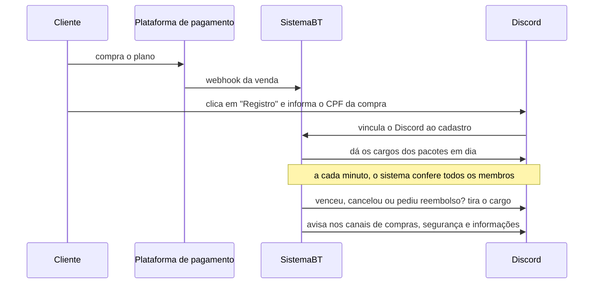

- **Acesso automático:** comprou, o cliente se registra pelo botão e recebe os cargos na hora. Venceu, cancelou ou teve chargeback, o cargo sai sozinho. Banido recebe o cargo de banido.
- **Combinações:** quem tem todos os pacotes de uma condição ganha o pacote combinado, e perde quando deixa de ter.
- **Painéis de autoatendimento:** mensagens com botões e formulários para registro, download dos indicadores e conexão de contas da Exness e da BingX, que liberam pacotes depois de verificadas pela API das corretoras.
- **Avisos automáticos:** compras, segurança, cargos dados e tirados, e o calendário econômico 5 minutos antes de cada notícia.
- **Administração pelo painel web:** hierarquia de cargos por arrastar e soltar, contagem de membros por cargo, padrões de permissão reutilizáveis, e painéis editados e publicados sem mexer em código. Criar um pacote já cria o cargo dele no Discord.
- **Sempre no ar:** o bot roda num serviço próprio, separado da API, que se reconecta sozinho se a conexão cair.

## Versão 1 · feita sem IA

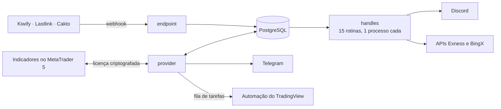

- **endpoint:** recebe e valida os webhooks e registra compras e cancelamentos.
- **handles:** 15 rotinas, cada uma num processo próprio: vencimentos, cargos do Discord, calendário econômico, verificação de contas de associados na Exness e na BingX, geração de imagens de sinais.
- **provider:** catálogo de pacotes, clientes e o servidor de licenças do MetaTrader.

## O servidor de licenças do MetaTrader 5

Evoluiu em 6 versões, cada uma fechando uma brecha encontrada em produção.

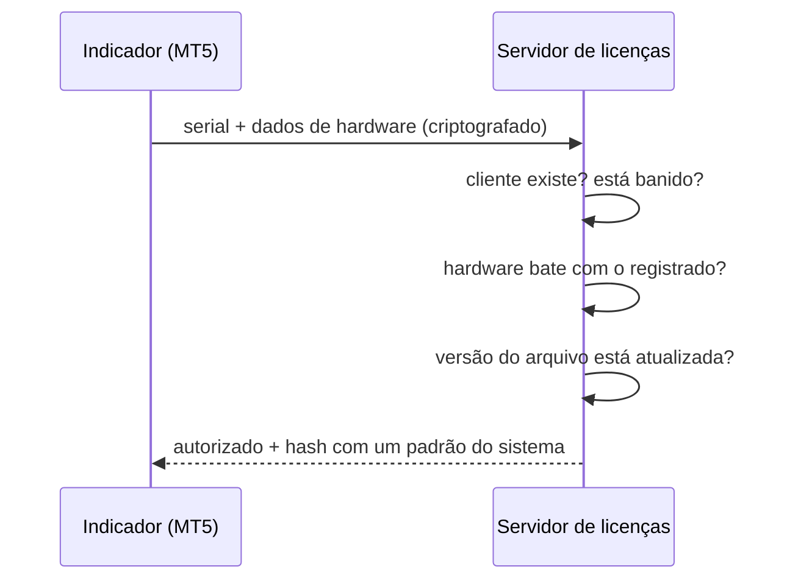

- Trava por hardware: informações sobre o sistema do cliente.
- Atualização automática: o servidor entrega o build certo para o processador de cada cliente.

## Versão 2 · reescrita, em produção

O legado funcionava, mas tinha problemas que só aparecem com o tempo. A V2 foi escrita com ajuda de IA; a arquitetura, as regras e a revisão são minhas.

| Problema no legado | Decisão na V2 |
| --- | --- |
| Rotinas sem supervisão: se uma caía, ninguém via | Supervisor com 1 processo do sistema por rotina, comandado pelo painel (ligar, desligar, reiniciar, mudar intervalo) |
| Dois supervisores rodando juntos duplicavam as rotinas | Trava no PostgreSQL (advisory lock): só um supervisor sobe por banco |
| Ligar ou mudar uma rotina exigia deploy | Configuração no banco, alterada pelo painel |
| A verificação de contas da Exness parava nos primeiros 1.000 clientes | A verificação percorre a lista inteira de clientes |
| Cargos do Discord eram tirados e devolvidos a cada minuto | O cargo só muda quando o acesso do cliente muda de fato |
| Reembolso e chargeback passavam sem aviso | Aviso automático de reembolso e chargeback |
| Serviços acessando o banco um do outro | Cada processo com seu banco e suas migrations; outro processo só lê pelo contrato |
| Segredos no código | Tudo vem do ambiente; nada sensível no repositório |

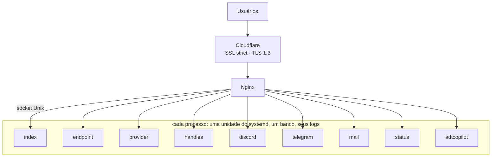

- **9 processos, 232 rotas e 8 bancos**, cada um com migrations próprias.
- **Dados pessoais:** o CPF dos clientes é salvo criptografado, respeitando a LGPD.
- **Painel em React**, com login pelo Clerk, logs de cada processo lidos do journald e página de status pública.
- **E-mails** pelo Resend (automáticos) e pela AWS SES (em massa).
- **Deploy** por `git push` para o servidor, com as unidades do systemd e a configuração do Nginx versionadas junto do código.

## Stack

Python · FastAPI · SQLAlchemy assíncrono · PostgreSQL · Alembic · React · TypeScript · Tailwind · Nginx · systemd · Cloudflare · AWS SES

## Telas

Painel da V2 em produção. Dados de clientes e endereços IP borrados.

**Provider:** acessos dos indicadores do MetaTrader nos últimos 30 dias: 12.293 acessos, 95,7% autorizados, 84 clientes.

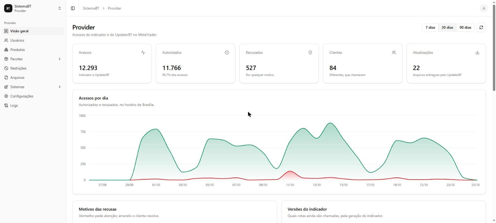

**Handles:** o supervisor no ar há 7 dias, 11 rotinas habilitadas, nenhuma falhando e nenhuma queda de processo.

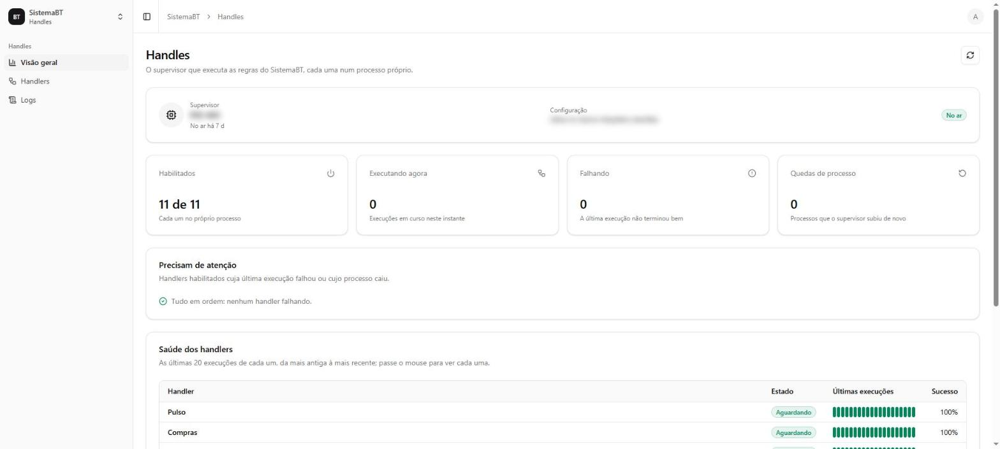

**Handlers:** as 11 rotinas, cada uma com estado, intervalo, última execução e os controles (ligar, executar agora, reiniciar, mudar intervalo).

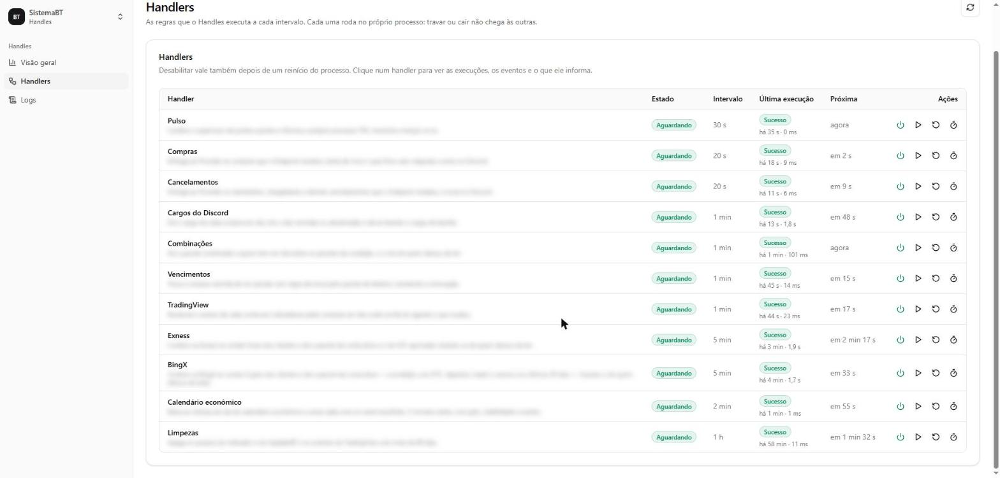

**Endpoint:** 17 rotas de webhook, cada uma mapeada para os pacotes que libera.

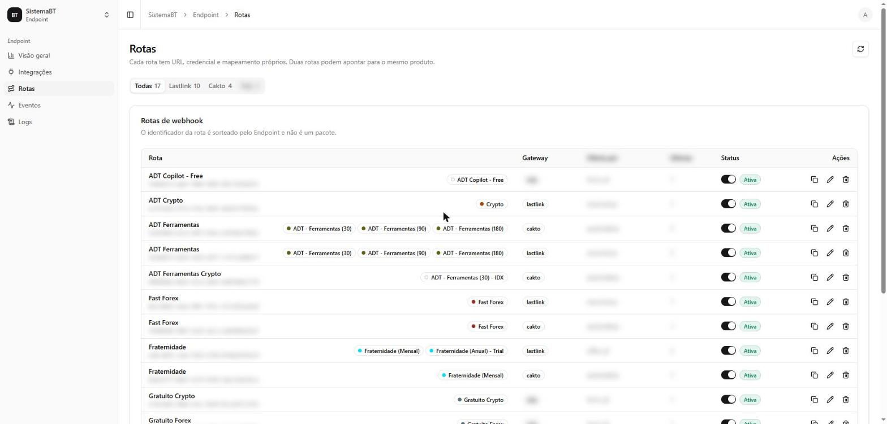

**Pacotes:** o catálogo, com renovação, combinações (como o trial que vira o plano anual) e status.

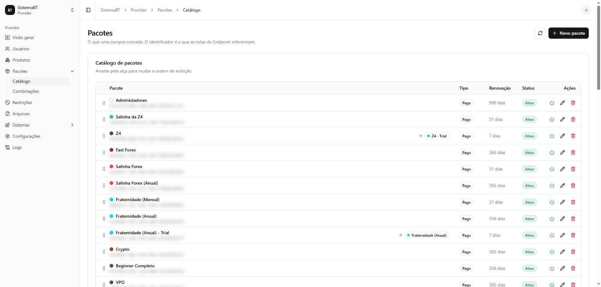

**Discord:** o servidor administrado pelo bot, com 1.065 membros e 67 cargos.

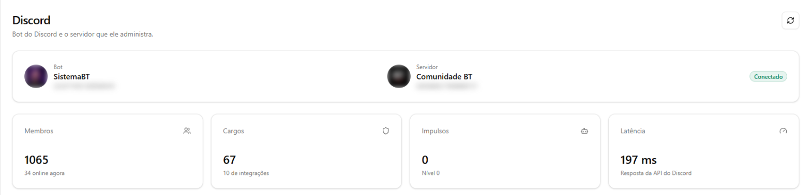

**Cargos:** a hierarquia do servidor, com membros por cargo e reorganização por arrastar.

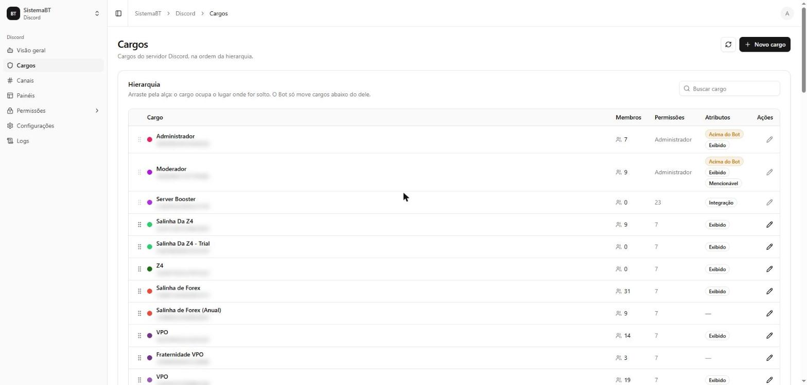

**Painéis:** o painel de registro, editado e publicado no Discord pelo próprio sistema.

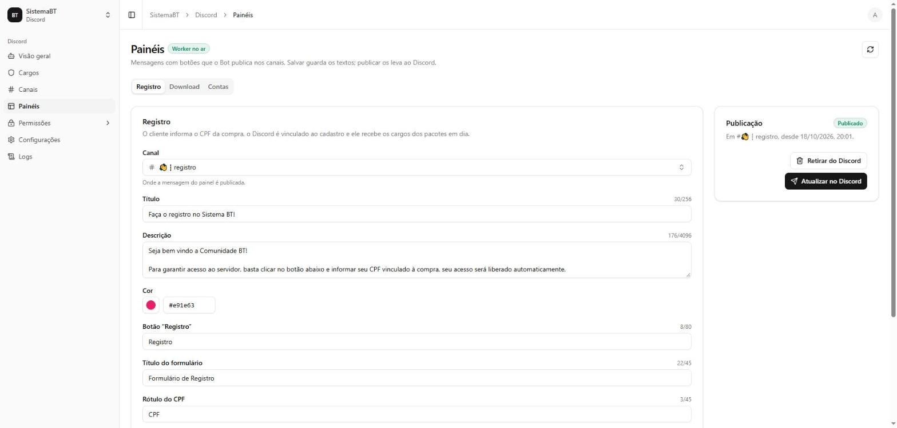

**Logs:** cada processo lê o próprio journald, com filtros por nível e acompanhamento ao vivo.

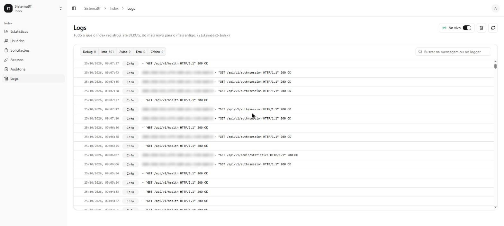
